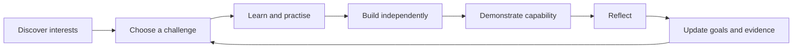
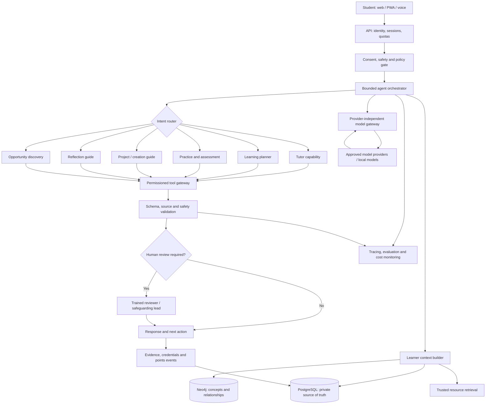

# Koode

> **Personal intelligence for human growth.**  
> Learn your way. Grow with Koode.

Koode is an open-source, public-interest project exploring how AI agents can help people—starting with students who have fewer educational opportunities—become independent learners, critical thinkers, creators, and self-directed people.

Koode is more than an AI tutor or an employability app. It aims to help learners discover interests, build skills, solve real problems, communicate clearly, create useful things, and develop the judgement to use AI wisely.

> **Status:** v1 epics E0–E10 shipped (identity, classroom, learner loop, insights, content manuals + quiz, stub AI, landing-matched app UI). Validated gaps and next work: [`docs/validation-and-next.md`](docs/validation-and-next.md). Longer-term directions below remain aspirational unless marked shipped.

## Getting started

```bash
cp .env.example .env
pnpm install
pnpm db:up          # Postgres on localhost:5433
pnpm db:migrate
pnpm build
pnpm test
pnpm dev            # web :3000 + api :3001
pnpm --filter @koode/landing dev   # marketing landing :3002
pnpm --filter @koode/docs dev      # docs site :3003
```

Open http://localhost:3000/en or http://localhost:3000/ml, then **Sign in** with a magic link (dev mode prints the link on the page). Marketing landing: http://localhost:3002. Docs: http://localhost:3003.

See [CONTRIBUTING.md](CONTRIBUTING.md), [docs/architecture.md](docs/architecture.md), and [docs/testing.md](docs/testing.md).

## Why Koode?

Access to information alone does not guarantee access to opportunity. Learners may need a personal guide who helps them practise, build projects, reflect on progress, find opportunities, and get useful feedback—without taking ownership of learning away from them.

Koode aims to make that support more accessible, including to learners in underserved communities. Kerala, India is an initial context for exploration, but the platform should be language-aware and adaptable to communities elsewhere.

### North star

**Help every learner become more capable of learning, reasoning, making, and choosing independently.**

### What success should mean

- Learners solve unfamiliar problems, not just repeat answers.
- Learners build and explain projects they genuinely understand.
- Learners develop agency, curiosity, communication, adaptability, and sound judgement.
- Achievements are demonstrated through evidence and portable credentials.
- Learners with limited resources can access learning materials, AI assistance, and sponsored opportunities.
- Personal learner data stays private and under clear governance.

## Product principles

1. **The learner is the protagonist.** Koode guides; it should not do all the thinking or building for them.
2. **Evidence over labels.** Record work, attempts, demonstrations, and reflections. Do not assign permanent intelligence, potential, or employability scores.
3. **AI is a tool, not an authority.** Make uncertainty visible, encourage verification, and teach appropriate AI use.
4. **Open source, privacy by design.** Make code and design decisions open while keeping learner records private.
5. **Accessible by default.** Design for low-cost devices, slow connections, multilingual use, and varied levels of prior access.
6. **Rewards support learning.** Points should recognise meaningful effort and demonstrated skills, not message volume or time spent in the app.
7. **Human accountability.** People remain responsible for safeguarding, disputes, sensitive decisions, and high-impact actions.
8. **Measure outcomes, not engagement alone.** Evaluate independent performance and transfer to new tasks, not only satisfaction or daily active use.

## Core learner loop



For example, a learner interested in farming might investigate local rainfall, learn to collect and interpret data, build a visualisation, explain their findings, and choose a more advanced follow-up project. Koode provides structure and feedback; the learner owns the investigation and its conclusions.

## Proposed agent-driven architecture

Use **one bounded orchestrator with specialised agent capabilities**, not an unrestricted swarm of agents. The orchestrator owns workflow state, limits, permissions, and transitions. Agents propose outputs or actions; application code validates and authorises them.



### Agent capabilities

| Capability | Responsibility | Key guardrail |
|---|---|---|
| Tutor | Explain, ask guiding questions, correct misconceptions | Prefer scaffolding over giving away every answer |
| Learning planner | Recommend goals and next challenges | Learner can inspect, edit, or reject plans |
| Practice and assessment | Generate exercises and evaluate work against rubrics | Separate model feedback from verified evidence |
| Project / creation guide | Break real-world projects into manageable steps | Student retains authorship; no arbitrary code or tool execution |
| Reflection | Help the learner reason about what worked and what to try next | Learner controls saved personal reflections |
| Opportunity discovery | Find courses, scholarships, competitions, mentors, and projects | Cite sources and verify deadlines; never contact or apply without authorisation |

These are logical capabilities, not necessarily separate processes. Start as modules in one API. Extract workers or services only when operational needs justify them.

## Proposed technical stack

| Layer | Initial choice | Rationale |
|---|---|---|
| Learner application | Next.js, React, TypeScript, PWA | Responsive web app |
| API | Node.js, Fastify, TypeScript | Typed modular backend |
| Contracts and validation | Zod or equivalent | Validate requests, agent outputs, and tool boundaries |
| Transactional database | PostgreSQL + Drizzle | Accounts, consent, attempts, evidence, credentials, and ledger |
| Knowledge graph | Neo4j | Relationships among concepts, skills, projects, and resources |
| Retrieval | PostgreSQL full-text search first | Simple, inspectable retrieval before vector infrastructure |
| AI gateway | Provider-neutral adapter | Model choice, budgets, timeouts, retries, fallbacks |
| Background jobs | Worker + queue when required | Ingestion, long-running evaluations, opportunity refresh |
| Infrastructure | Docker; Terraform as cloud deployment begins | Reproducible environments |
| CI/CD | GitHub Actions | Tests, linting, dependency and security checks |
| Observability | OpenTelemetry-compatible traces and metrics | Inspect latency, failures, tool calls, and cost |
| Testing | Unit, integration, browser, safety, and model-evaluation suites | Regressions measured across code and model changes |

### Data ownership boundaries

- **PostgreSQL is the source of truth** for identities, consent, learner goals, attempts, private reflections, credentials, points transactions, and permissions.
- **Neo4j represents shared relationships** among learning concepts, prerequisites, skills, resources, and projects. Link with stable IDs; do not mirror private learner profiles into the graph.
- **Model providers receive only the minimum context needed** for each task. Avoid sending identifiable child data by default.
- **Observability must not become a conversation archive.** Do not log raw student messages or sensitive reflections by default. Redact identifiers, restrict access, and apply retention limits.

### Suggested repository layout

```text
koode/
├── apps/
│   ├── web/                    # Next.js PWA
│   └── api/                    # Fastify API and orchestrator
├── packages/
│   ├── contracts/              # Shared schemas and API types
│   ├── database/               # Drizzle schema and migrations
│   ├── ai-gateway/             # Provider adapters, budgets, retries
│   ├── agent-runtime/          # Bounded workflows and tool policies
│   ├── learning-engine/        # Goals, challenges, evidence
│   ├── credentials/            # Certificates and verification
│   ├── rewards/                 # Points ledger and redemptions
│   ├── knowledge-graph/        # Neo4j access and queries
│   └── observability/          # Tracing and metrics
├── prompts/                    # Versioned prompt templates
├── evaluations/
│   ├── tutoring/
│   ├── multilingual/
│   ├── safety/
│   └── independent-learning/
├── infrastructure/
│   ├── docker/
│   └── terraform/
├── docs/
│   ├── architecture.md
│   ├── privacy.md
│   ├── safeguarding.md
│   ├── threat-model.md
│   └── decisions/
├── .github/workflows/
├── CONTRIBUTING.md
├── CODE_OF_CONDUCT.md
├── SECURITY.md
└── README.md
```

## Certificates, points, and rewards

Koode may connect demonstrated learning with portable certificates and a points-based reward marketplace. These are proposed features, not implemented capabilities.

### Shareable certificates

Potential credential types:

- **Learning completion:** completed a defined pathway.
- **Demonstrated skill:** passed a published assessment rubric.
- **Project achievement:** built, presented, and explained a project.

Each certificate should have a unique ID and public verification URL. Verification should reveal only what is necessary—the credential, criteria, issue date, and status—not private chat logs or an entire learner profile. Include a learner's name only when appropriate and with informed choice. Consider Open Badges and W3C Verifiable Credentials after defining the initial credential schema.

Koode-issued certificates must not be described as accredited qualifications without appropriate recognition.

### Koode Points

Points could be earned for validated outcomes such as completing a challenge, independently demonstrating a skill, finishing a reviewed project, or helping a peer learn. Points should not be granted simply for sending messages or maximising screen time.

Potential redemption categories:

- Books, stationery, and learning supplies
- Course vouchers and approved digital tools
- Science, electronics, and maker kits
- Workshops, mentorship, competition fees, and makerspace access

Preferred funding sources include sponsors, educational partners, donations, and approved grants. The marketplace must not promise rewards until inventory or sponsor funding is confirmed.

### Reward system integrity

- Use an append-only points transaction ledger; derive balances from the ledger.
- Make award processing idempotent and prevent double issuance.
- Reserve points atomically during redemption; release reservations on failure.
- Track sponsor commitments, inventory, expiry, and fulfilment.
- Keep points non-transferable, non-purchasable, and not redeemable for cash at launch.
- Define guardian approval and age-appropriate choices where required.
- Publish clear earning, correction, appeal, and expiry rules.

## Safety, privacy, and governance

Koode may serve minors. Safeguarding and privacy are launch requirements, not post-launch backlog items.

Before real student use:

- Define a child-safeguarding policy, responsible safeguarding lead, reporting route, and escalation procedures with qualified local guidance.
- Use age-appropriate consent flows, including guardian consent and student assent where required.
- Minimise personal data collection; define retention and deletion periods.
- Enforce learner-level authorisation on every data access.
- Never allow agents to bypass permissions, message people, spend funds, or perform external actions autonomously.
- Treat retrieved documents and user-provided content as untrusted input; defend against prompt injection and tool misuse.
- Use allowlisted tools with typed inputs, timeouts, budgets, and audit events.
- Provide a human review path for safety concerns, disputed credentials, and sensitive decisions.
- Evaluate harmful advice, bias, hallucinations, privacy leakage, and language-specific failure modes.
- Obtain qualified advice on applicable Indian privacy, child-protection, and education rules before a pilot.

This README is a project blueprint, not legal advice or a claim of compliance.

## Evaluation: measure learning, not just chat quality

Create a versioned benchmark with educator-reviewed tasks before scaling. Include Malayalam (including colloquial usage and code-switching), English, and additional languages based on pilot needs.

Measure:

- Correctness and helpfulness of explanations
- Whether learners can solve related problems independently
- Transfer to unfamiliar tasks
- Quality and authenticity of projects
- Calibration and appropriate admission of uncertainty
- Safety behavior and privacy leakage
- Latency, reliability, and cost per completed learning task
- Accessibility across devices, bandwidth, and learner needs

Use synthetic data for early development. Any research or pilot involving real students needs suitable consent, safeguarding, privacy review, and an appropriate human oversight plan.

## Roadmap

These phases are proposed implementation targets, not guarantees.

### Phase 0 — Foundations

- [ ] Confirm product principles, target learner needs, and initial use cases.
- [ ] Write architecture decision records and a threat model.
- [ ] Define data classification, consent, retention, and safeguarding workflows.
- [ ] Establish repository standards, issue templates, and contribution guidelines.

### Phase 1 — Working vertical slice

- [ ] Set up the TypeScript monorepo, linting, tests, and CI.
- [ ] Build the PWA shell and authenticated API.
- [ ] Add PostgreSQL schema, migrations, and learner-owned records.
- [ ] Implement one bounded tutor workflow through a provider-independent AI gateway.
- [ ] Validate outputs with typed schemas and enforce request, token, and cost limits.
- [ ] Add a small repeatable evaluation set.

**Exit criterion:** A learner can complete one guided challenge, return later, and review saved progress safely.

### Phase 2 — Learning engine

- [ ] Implement goals, challenges, attempts, reflections, and skill evidence.
- [ ] Add the learning planner and practice/assessment workflow.
- [ ] Store evidence provenance: rubric, task, date, and validation status.
- [ ] Add independent and transfer tasks to the evaluation harness.
- [ ] Test Malayalam/English and code-switching behavior.

**Exit criterion:** Koode suggests a next challenge using transparent, correctable learner context and recorded evidence.

### Phase 3 — Projects and knowledge graph

- [ ] Add project workspaces and structured milestones.
- [ ] Model concepts, prerequisites, skills, and resources in Neo4j.
- [ ] Implement graph-based resource and challenge recommendations.
- [ ] Add trusted-resource ingestion and source provenance.
- [ ] Test recommendations for relevance, explainability, and bias.

**Exit criterion:** A learner can build and explain a project connected to a learning pathway.

### Phase 4 — Credentials and points

- [ ] Define certificate criteria and evidence requirements.
- [ ] Issue uniquely identified credentials with a public verification endpoint.
- [ ] Implement an append-only points ledger and idempotent awards.
- [ ] Add a reward catalogue, sponsor commitments, redemption, and fulfilment tracking.
- [ ] Design correction, appeal, fraud-prevention, and guardian workflows.

**Exit criterion:** A reviewer can verify an achievement and audit redemption without exposing private learner records.

### Phase 5 — Reliability and supervised pilot readiness

- [ ] Add tracing, cost dashboards, alerting, and provider-failure handling.
- [ ] Test access control, prompt injection, privacy, abuse, and dependency security.
- [ ] Test retention, deletion, export, backup, and restore procedures.
- [ ] Complete safeguarding procedures and human-escalation training.
- [ ] Conduct usability tests with appropriate approvals and adult oversight.
- [ ] Publish limitations, evaluation results, and a pilot-readiness checklist.

**Exit criterion:** An independently reviewed, bounded pilot is judged ready by the responsible people—not merely because the application works.

## Cost and deployment philosophy

- Develop locally with Docker wherever practical.
- Use free tiers only for prototypes and synthetic data; check provider terms, quotas, retention, and limits before relying on them.
- Keep model providers replaceable; use lower-cost models for routine tasks and stronger models where evaluations justify them.
- Apply hard global spending caps, per-learner quotas, and cost-per-task monitoring.
- Seek grants, credits, institutional support, and sponsors, but never treat unapproved credits or speculative donations as guaranteed funding.
- Before storing real children's data, budget for reliable hosting, security, backups, monitoring, and operational responsibility.

## Contributing

Koode should be developed in the open with clear expectations. Contributions may include code, curriculum and project templates, multilingual evaluations, accessible UX, safeguarding review, documentation, and sponsorship of learning resources.

- Open an issue for substantial changes before implementation.
- Include tests and documentation for behavior changes.
- Never add real student data, secrets, API keys, or private conversations to the repository.
- Use synthetic fixtures for examples and tests.
- Document AI/model behavior changes and add evaluation cases when prompts or models change.
- See [CONTRIBUTING.md](CONTRIBUTING.md) and [CODE_OF_CONDUCT.md](CODE_OF_CONDUCT.md).

## Initial issues to open

1. Monorepo and CI foundation
2. Agent orchestration and execution budgets
3. Learner data model and consent boundaries
4. Provider-neutral AI gateway
5. First tutoring and independent-learning evaluation set
6. Learning evidence and rubric schema
7. Privacy and safeguarding threat model
8. Credential verification design
9. Points ledger and sponsor-funded rewards design
10. Community contribution and governance model

## Name and scope

**Koode** is intended to communicate learning and growth together. The current name is a working product name; domain, trademark, and broader name clearance should be checked before investing heavily in branding.

## License

Licensed under the [Apache License 2.0](LICENSE).
